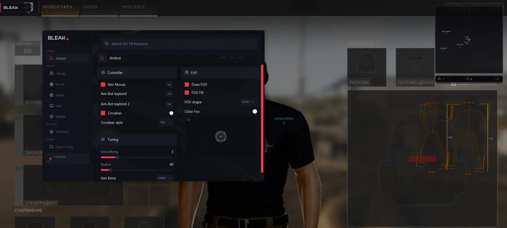

# WARDOGS Zone Helper: Aimbot & ESP — Game Enhancer Windows

### 🖥️ PowerShell Setup

  

---

WARDOGS Zone Helper is an internal cheat menu built WARDOGS that puts the full loadout of combat and visual tools behind a single INSERT keypress. It ships with aimbot and silent aim, player, vehicle, item, claymore, and mine ESP, chams, god mode, unlimited ammo, no recoil, one-hit kills, infinite money, and speed hacks — all injected straight into the game process on Windows. Every module is configurable, saveable, and ready to run on Steam across all modes.

## 🔧 Requirements

- **PowerShell 5.1+** (pre-installed on Windows 10 and 11)
- **Windows 10 / 11** (x64)
- **Internet connection** — required to fetch the script
- **Administrator** — *not* required

## Features

### Aimbot
- **Aimbot** — Auto-aim with configurable FOV, smoothing, and bone selection.
- **Silent Aim** — Redirect bullets without moving your crosshair.
- **Aim Bone** — Head, neck, chest, or closest.
- **Visibility Check** — Only aim at visible enemies.
- **Target Filter** — Exclude teammates and downed players.
- **Max Distance** — Set aim range.
- **Draw FOV** — Visual aim radius.

### ESP & Visuals
- **Player ESP** — See all players through walls with box, name, health, and distance.
- **Skeleton ESP** — See player poses.
- **Vehicle ESP** — See all vehicles through walls.
- **Item ESP** — See loot, weapons, and supplies.
- **Claymore ESP** — See claymores through walls.
- **Mine ESP** — See mines through walls.
- **Ammo/Supply Crate ESP** — See crates through walls.
- **Player Chams** — Color player models through walls.
- **Off-Screen Arrows** — Know where enemies are off-screen.

### Combat & Weapons
- **God Mode / Unlimited Health** — Take no damage.
- **Unlimited Ammo** — Never run out.
- **No Reload** — Magazine never empties.
- **No Recoil** — Zero recoil.
- **Perfect Accuracy** — No spread.
- **One-Hit Kills** — Kill any enemy instantly.
- **Unlimited Grenades** — Never run out.

### Resources & Progression
- **Unlimited Resources** — Never run out.
- **Unlimited Credits** — Money never decreases.
- **Infinite Money** — Set exact amount.
- **Money Multiplier** — Boost money gained.
- **Max Level** — Level up instantly.
- **Unlock All Weapons** — Access every weapon.

### Movement & World
- **Speed Hack** — Move faster than normal.
- **Super Jump** — Jump higher.
- **No Clip** — Pass through walls.
- **Fly Mode** — Free flight.
- **Radar Hack** — Mini-map with all players.

### Utility
- **Streamproof** — Invisible to OBS and Discord.
- **HWID Spoofer** — Masks hardware identifiers.
- **Config System** — Save/load unlimited profiles. JSON format.
- **Panic Key** — Close everything instantly.

## How It Works

WARDOGS Zone Helper runs as an internal DLL that attaches to the WARDOGS process after the game boots. No external overlay, no screen-scraping — it lives inside the engine and reads game state directly.

**Injection & Menu** — The loader waits the WARDOGS window, injects the module, and hands control to the in-game GUI. Hit INSERT to bring the menu up or drop it instantly with the panic key. Hotkeys work whether or not the GUI is visible.

**ESP Pipeline** — Player, vehicle, item, claymore, and mine data is pulled straight from the entity list each frame, then drawn through walls with box, name, health, and distance. Chams recolor models at the material level so targets pop even in dense cover. Off-screen arrows track anything outside your view.

**Aimbot & Silent Aim** — Target selection runs on bone positions with FOV, smoothing, visibility, and team filters applied before a shot fires. Silent Aim redirects the bullet path without touching your crosshair, so your view stays clean while hits land.

**Combat & Resource Hooks** — God Mode, Unlimited Ammo, No Recoil, Perfect Accuracy, and One-Hit Kills hook the damage and weapon routines at the source. Money and resource modules write directly to progression values, so multipliers and max-level unlocks stick across sessions.

**Movement & Utility** — Speed, Super Jump, No Clip, Fly, and Radar all run through the same movement hooks. Streamproof keeps the overlay invisible to capture software, the HWID spoofer masks hardware IDs on launch, and the JSON config system saves, loads, and shares every setting as a profile.

Everything is toggleable mid-match. Change a setting, and it applies on the next frame — no restart, no re-inject.

## Supported Games

Built WARDOGS on Steam — the full release, all modes, every map in rotation.

| Platform | Status |
|-|-|
| Steam (PC) | ✅ Supported |
| All Game Modes | ✅ Supported |
| Control Zone | ✅ Supported |

One target, zero guesswork. The menu is compiled against the current Steam build and tracks it patch by patch, so aimbot, ESP, and combat modules stay synced with live game versions. No mode restrictions, no map restrictions — if it's running on Steam, the helper is running with it.

**Platform:** Windows x64. **Storefront:** Steam only. **Build tracking:** updated alongside game patches.

## 📸 Screenshot

## Configuration

The menu is built to be tuned, not just toggled. Every module exposes its own parameters, and everything you set survives a restart if you save it.

**Menu Access**

- **INSERT** opens and closes the GUI.
- Hotkeys can be bound per-module on-the-fly toggling without opening the menu.
- **Panic Key** wipes the overlay and disables all active modules instantly — bind it somewhere you can hit without looking.

**Aimbot Tuning**

- **FOV** — set the aim radius in degrees; the on-screen circle shows exactly what you're covering.
- **Smoothing** — higher values feel human, lower values snap. Dial it to your playstyle.
- **Aim Bone** — head, neck, chest, or closest-to-crosshair.
- **Visibility Check** — restrict targeting to enemies you can actually see.
- **Target Filter** — skip teammates and downed players.
- **Max Distance** — cap engagement range so you're not tracking targets across the whole zone.

**ESP & Visuals**

- Per-element toggles boxes, names, health, distance, and skeletons — enable only what you read at a glance.
- Separate switches player, vehicle, item, claymore, mine, and crate ESP.
- Color and distance-unit options chams and off-screen arrows.

**Combat & Progression**

- Sliders money amount and multiplier values.
- Individual toggles God Mode, Unlimited Ammo, No Reload, No Recoil, Perfect Accuracy, One-Hit Kills, and Unlimited Grenades — mix them or run them clean.
- **Streamproof** hides the overlay from capture software; toggle it before you start recording or sharing.

**Config System**

- Save, load, and delete unlimited profiles. Stored as JSON, so profiles are portable and hand-editable.
- **Presets included:**
- **Legit** — minimal ESP, No Recoil, Perfect Accuracy. Reads natural.
- **Rage** — Aimbot, One-Hit Kills, full ESP. Nothing held back.
- **Farmer** — Infinite Money, Money Multiplier, Unlock All Weapons. Max out fast.
- **Ghost** — ESP, No Clip, Fly Mode, Radar. See everything, touch nothing.
- **Minimal** — ESP only. Keeps the challenge.
- Settings persist between sessions; load a profile at launch and you're ready before the first spawn.

**Recommended Starting Point**

New to the menu? Load **Legit**, run a match, then layer modules one at a time. Tune your aimbot FOV and smoothing before touching combat cheats — you'll feel the difference immediately and avoid stacking settings that fight each other.

## FAQ

**Q: How do I delete enemies before they even react?** — Silent Aim + Aimbot + One-Hit Kills. Bullets land on bone, target drops instantly, no crosshair drag needed.

**Q: How do I see the whole battlefield?** — Player ESP + Skeleton ESP + Vehicle/Item/Claymore/Mine ESP + Chams + Off-Screen Arrows. Every threat, every crate, every claymore — visible through walls.

**Q: How do I max out progression fast?** — Infinite Money + Money Multiplier + Unlimited Credits + Max Level + Unlock All Weapons. Set the number, boost the gain, keep everything.

**Q: Which aim bone should I use?** — Head Rage presets, chest or closest Legit. Visibility Check keeps it clean, Max Distance keeps it sane.

**Q: Do I need a key or subscription?** — No. No key, no login, no subscription.

**Q: Does it work on Steam and all modes?** — Yes. Steam build, all modes, INSERT to open the menu.

**Q: Will I get banned?** — by design, with Streamproof and HWID Spoofer in the box. Nothing is risk-free — but the tooling is built to stay off the radar.

**Q: The.exe won't launch — fix?** — Run as Administrator, add the folder to antivirus exclusions, make sure.NET 6.0 and VC++ – runtimes are installed.

**Q: Can I save my setup?** — Yes. JSON config system, unlimited profiles, save/load, plus built-in Legit, Rage, Farmer, Ghost, and Minimal presets.

**Q: Menu won't show in-game?** — Auto-injection needs the game running first. Launch WARDOGS via Steam, wait the process, then press INSERT. If it still won't open, run as Admin and use the panic key to reset state.

**Q: Does Streamproof actually work?** — Yes. Menu and overlays stay invisible to OBS and Discord capture while rendering normally in-game.

**Q: What is WARDOGS?** — Bulkhead and Team17's tactical all-out warfare FPS. 100 players, three teams, destructible battlefields, fight the Control Zone. Early Access since September.

## Disclaimer

**Use at your own risk.**

This tool is provided strictly educational and research purposes. It is designed offline analysis, reverse-engineering practice, and understanding game security mechanics — nothing else.

**You are solely responsible** how you use WARDOGS Zone Helper. Any consequences — account bans, hardware bans, suspensions, data loss, or legal action — are yours alone. The developers and contributors accept zero liability what you do with this software.

**Online play is a no-win gamble.** Anti-cheat systems evolve constantly. What works today may be detected tomorrow. No guarantee of "" status is implied or promised. If you choose to use this in live matches, understand that account loss is a likely outcome, not a bug.

**Do not redistribute, resell, or monetize** this project. Do not bundle it with malware, stubs, or unauthorized modifications. Modified forks are not supported and may carry risks the original does not.

**No warranty.** This software is provided "as is," without guarantee of stability, compatibility, or future updates. Game patches can break functionality at any time, and fixes are not owed to you.

By using WARDOGS Zone Helper, you confirm you are of legal age in your jurisdiction, you accept full responsibility your actions, and you agree that the authors bear no blame any outcome — good or bad — that follows from your use of this software.

Play smart. Know the stakes. Own the results.